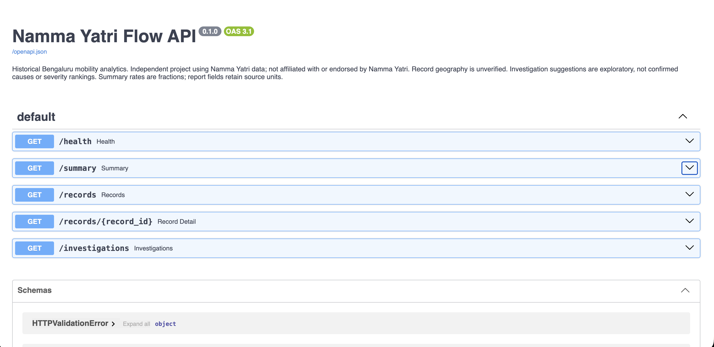
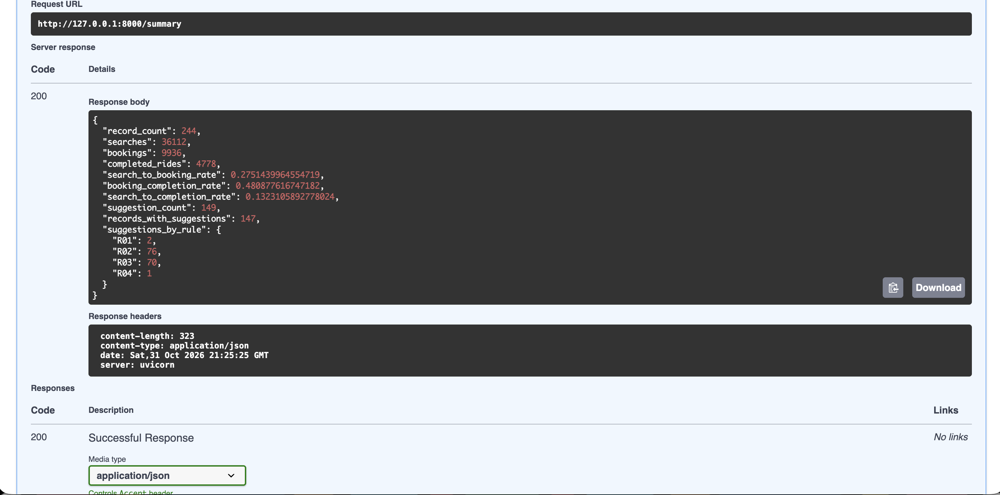

# Namma Yatri Flow — Bengaluru Mobility Analytics

Independent analytics project using Namma Yatri data. Not affiliated with or endorsed by Namma Yatri.

## Run locally

Use Python 3.13. From this folder:

```sh
python3.13 -m venv .venv
source .venv/bin/activate
python -m pip install -r requirements.txt
python tests/check_api.py
python -m uvicorn api:app --host 127.0.0.1 --port 8000
```

API documentation: http://127.0.0.1:8000/docs
In another terminal, activate the environment and run `python -m streamlit run streamlit_app.py`.

Endpoints: `/health`, `/summary`, `/records`, `/records/{record_id}`, `/investigations`.
Lists accept offset and limit (1–250). Investigations accept record_id and rule_id. Unknown identifiers return 404; invalid pagination returns 422. Valid filters with no matches return an empty list.

## Validation and limitations

The supplied Colab notebook records passing TestClient integration checks for 244 profiles, 149 suggestions, aggregate rates, all record details, null completion rates, filters, pagination and invalid requests. Python syntax was checked during packaging. A fresh Python 3.13 macOS installation and local TestClient checks passed, as shown in the user-provided Terminal screenshots. Live Uvicorn startup, /health, /docs, and /summary were confirmed in browser screenshots; the server then shut down cleanly. Public deployment remains pending. Requirements pin direct dependencies only, not the full dependency tree. pandas 2.2.3 comes from the prior local dashboard environment; other pins come from notebook outputs.

Summary rates are fractions; report fields retain source units. Missing report values become JSON null. Geography is unverified; clusters and anomalies are exploratory. Suggestions are investigation prompts, not confirmed causes or severity rankings. The API serves historical reports and does not perform validated forecasting.

Dashboard and notebook generation now use the same display name. Legacy Colab preview cells are optional; local preview is preferred. The full historical pipeline has not been independently rerun. No deployment or GitHub upload is included.

## API screenshots




